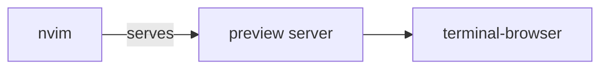

# nvim

Personal Neovim configuration, built on [lazy.nvim](https://github.com/folke/lazy.nvim).

## Install

```sh
git clone https://github.com/paolosimone/nvim ~/.config/nvim
nvim
```

lazy.nvim bootstraps itself and installs the plugins on first launch.

## Structure

- `init.lua` – entry point: loads keymaps, options, then lazy.nvim
- `lua/config/` – `keymaps.lua`, `options.lua`, `lazy.lua` (plugin manager bootstrap)
- `lua/plugins/` – one spec file per plugin, auto-imported by lazy.nvim
- `lazy-lock.json` – pinned plugin versions

## Plugins

| Plugin                                                              | Purpose                                  |
|---------------------------------------------------------------------|------------------------------------------|
| [catppuccin](https://github.com/catppuccin/nvim)                    | Color scheme                             |
| [autopairs](https://github.com/windwp/nvim-autopairs)               | Auto-close brackets and quotes           |
| [blink.cmp](https://github.com/saghen/blink.cmp)                    | Autocompletion                           |
| [diffview](https://github.com/sindrets/diffview.nvim)               | Git diffs, file history, merge conflicts |
| [fugitive](https://github.com/tpope/vim-fugitive)                   | Git commands inside Neovim               |
| [gitsigns](https://github.com/lewis6991/gitsigns.nvim)              | Git change signs in the gutter           |
| [guess-indent](https://github.com/nmac427/guess-indent.nvim)        | Automatic indentation detection          |
| [lspconfig](https://github.com/neovim/nvim-lspconfig)               | Language server configuration            |
| [lualine](https://github.com/nvim-lualine/lualine.nvim)             | Statusline and tab line (tab pages)      |
| [markdown-preview](https://github.com/iamcco/markdown-preview.nvim) | Live markdown preview in a browser       |
| [mason](https://github.com/mason-org/mason.nvim)                    | Install and manage LSP servers and tools |
| [multicursor](https://github.com/jake-stewart/multicursor.nvim)     | Multiple cursors                         |
| [neo-tree](https://github.com/nvim-neo-tree/neo-tree.nvim)          | File explorer sidebar                    |
| [quicker](https://github.com/stevearc/quicker.nvim)                 | Editable quickfix (find & replace)       |
| [surround](https://github.com/kylechui/nvim-surround)               | Add, change and delete surrounding pairs |
| [telescope](https://github.com/nvim-telescope/telescope.nvim)       | Fuzzy finder for files, text and more    |
| [window-picker](https://github.com/s1n7ax/nvim-window-picker)       | Pick a window by letter                  |

## Markdown preview

`<leader>mp` toggles a live preview in markdown buffers. Requires
`brew install terminal-browser`: in Ghostty (1.3+) the preview opens in a split
pane to the right; otherwise it falls back to the system browser.

Test diagram (renders in the preview):



## Devcontainers

To use this config inside a devcontainer, the container needs neovim and the
tools the config relies on (`curl`, `git`, `ripgrep`, `make`). The host config
is mounted read-only, so it stays the single source of truth, while neovim's
data, state and cache live in named volumes and survive container restarts (no
plugin reinstall each time).

The setup has three files: a `Dockerfile` that installs the dependencies, a
`docker-compose.yml` that mounts the project and config, and a
`devcontainer.json` that ties them together. Adjust `/absolute/path/to/pwd` to
the host project path, and the `/home/app` and `/app` paths to the container
user's home. The Dockerfile uses the arm64 neovim build; switch to
`nvim-linux-x86_64.appimage` on x86 hosts. Port `8090` is forwarded so the
markdown preview is reachable from the host browser.

**Dockerfile**

```docker
# Install/update system libraries.
RUN apt-get update && \
    apt-get upgrade -y make && \
    apt-get install -qqy curl git ripgrep && \
    apt-get clean

# Install neovim
RUN curl -LO https://github.com/neovim/neovim/releases/latest/download/nvim-linux-arm64.appimage && \
    chmod +x nvim-linux-arm64.appimage && \
    ./nvim-linux-arm64.appimage --appimage-extract && \
    mv squashfs-root /opt/nvim && \
    chmod -R a+rX /opt/nvim && \
    ln -s /opt/nvim/AppRun /usr/bin/nvim && \
    rm nvim-linux-arm64.appimage
```

**docker-compose**

```yaml
services:
  dev:
    build:
      context: .
    volumes:
      # Mount project files
      - "../.:/absolute/path/to/pwd"
      # Share neovim config from host
      - "~/.config/nvim:/home/app/.config/nvim:ro"
      # Keep neovim state across container restarts
      - "nvim-share:/app/.local/share"
      - "nvim-state:/app/.local/state"
      - "nvim-cache:/app/.cache"
    working_dir: /absolute/path/to/pwd
    entrypoint: sleep
    command: infinity

volumes:
  nvim-share:
  nvim-state:
  nvim-cache:
```

**devcontainer**

```json
{
    "name": "Development Environment",
  
    "dockerComposeFile": [
      "./docker-compose.yml"
    ],
  
    "service": "dev",
  
    "workspaceFolder": "${localWorkspaceFolder}",
  
    // Serving
    "forwardPorts": [8090],
    "portsAttributes": { "8090": { "label": "markdown" } },
  }
```
