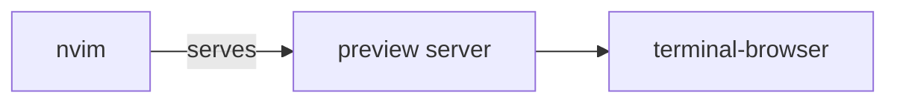

# nvim

Personal Neovim configuration, built on [lazy.nvim](https://github.com/folke/lazy.nvim).

## Install

```sh
git clone https://github.com/paolosimone/nvim ~/.config/nvim
nvim
```

lazy.nvim bootstraps itself and installs the plugins on first launch.

## Structure

- `init.lua` – entry point: loads keymaps, options, then lazy.nvim
- `lua/config/` – `keymaps.lua`, `options.lua`, `lazy.lua` (plugin manager bootstrap)
- `lua/plugins/` – one spec file per plugin, auto-imported by lazy.nvim
- `lazy-lock.json` – pinned plugin versions

## Plugins

| Plugin                                                              | Purpose                                  |
|---------------------------------------------------------------------|------------------------------------------|
| [catppuccin](https://github.com/catppuccin/nvim)                    | Color scheme                             |
| [blink.cmp](https://github.com/saghen/blink.cmp)                    | Autocompletion                           |
| [diffview](https://github.com/sindrets/diffview.nvim)               | Git diffs, file history, merge conflicts |
| [fugitive](https://github.com/tpope/vim-fugitive)                   | Git commands inside Neovim               |
| [gitsigns](https://github.com/lewis6991/gitsigns.nvim)              | Git change signs in the gutter           |
| [guess-indent](https://github.com/nmac427/guess-indent.nvim)        | Automatic indentation detection          |
| [lspconfig](https://github.com/neovim/nvim-lspconfig)               | Language server configuration            |
| [lualine](https://github.com/nvim-lualine/lualine.nvim)             | Statusline and tab line (tab pages)      |
| [markdown-preview](https://github.com/iamcco/markdown-preview.nvim) | Live markdown preview in a browser       |
| [mason](https://github.com/mason-org/mason.nvim)                    | Install and manage LSP servers and tools |
| [neo-tree](https://github.com/nvim-neo-tree/neo-tree.nvim)          | File explorer sidebar                    |
| [telescope](https://github.com/nvim-telescope/telescope.nvim)       | Fuzzy finder for files, text and more    |
| [window-picker](https://github.com/s1n7ax/nvim-window-picker)       | Pick a window by letter                  |

## Markdown preview

`<leader>mp` toggles a live preview in markdown buffers. Requires `brew install terminal-browser`: in Ghostty (1.3+) the preview opens in a split pane to the right; otherwise it falls back to the system browser.

Test diagram (renders in the preview):


